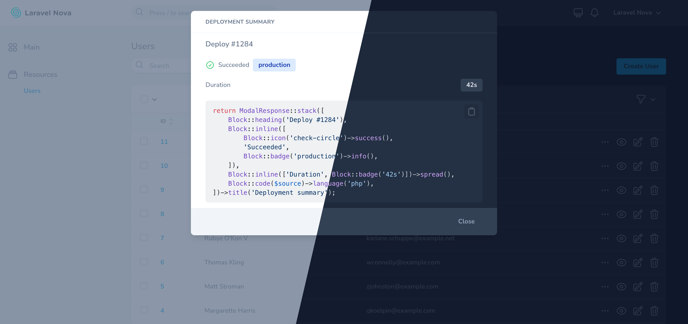
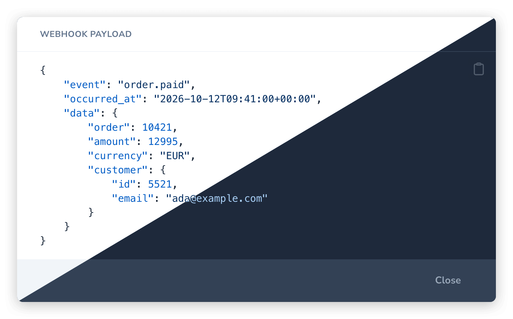
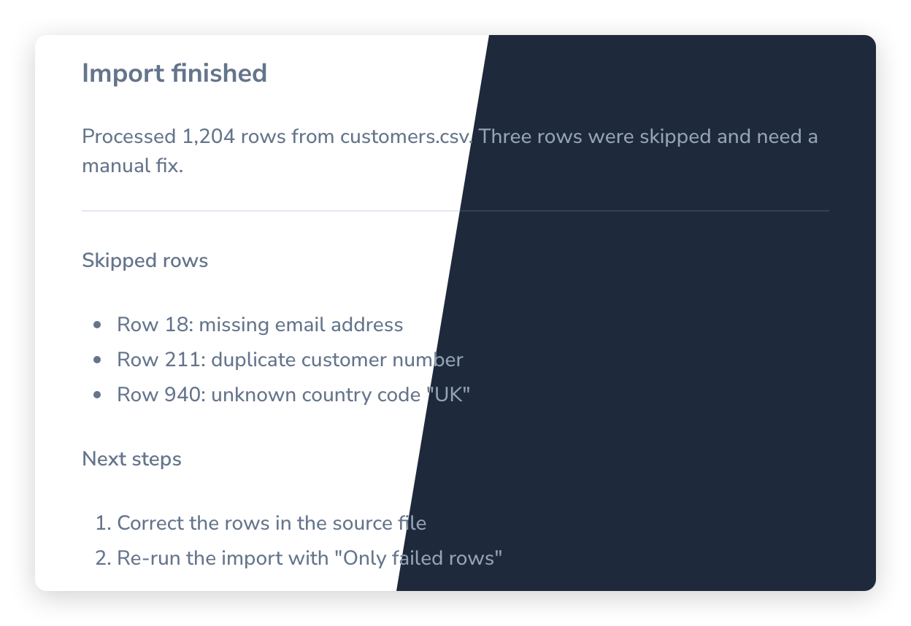
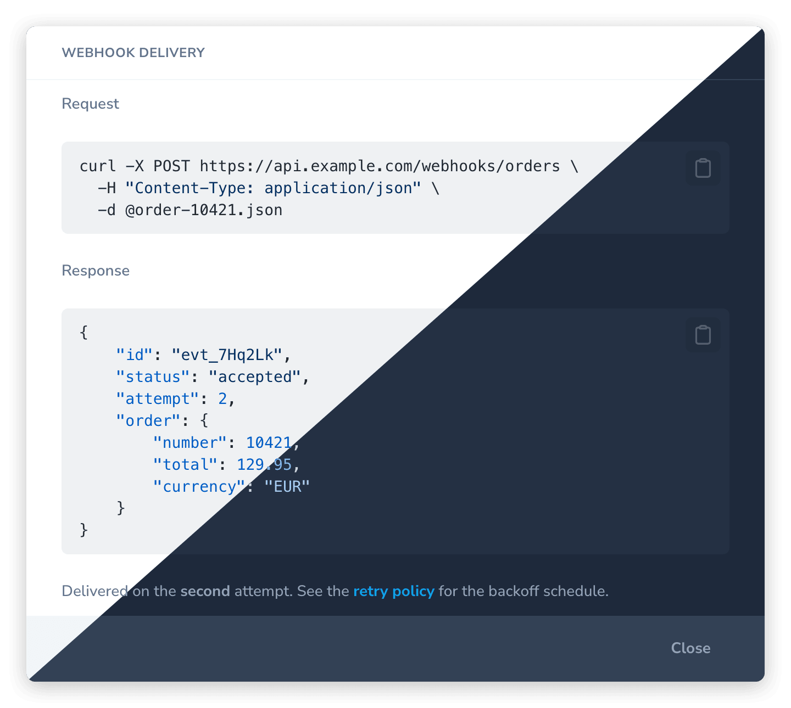
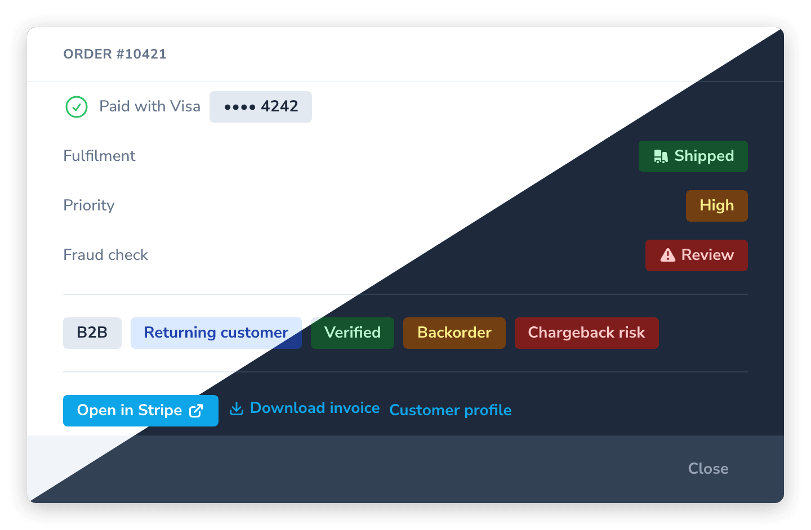
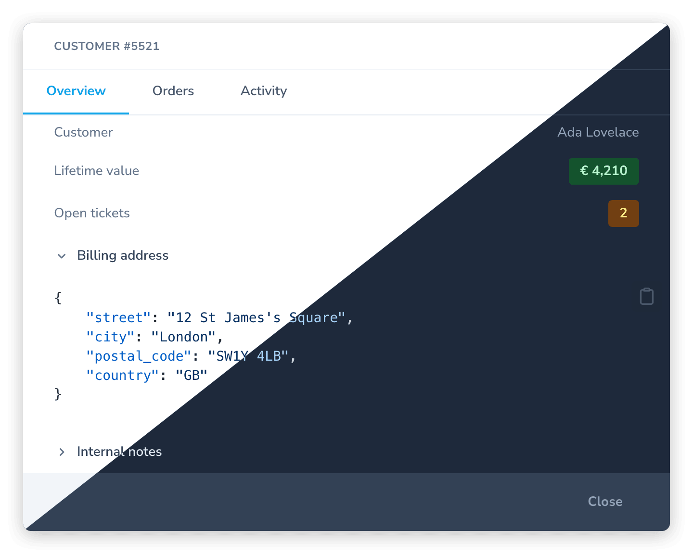

# Nova Modal Response

[](https://github.com/markwalet/nova-modal-response/actions)
[](https://packagist.org/packages/markwalet/nova-modal-response)
[](https://packagist.org/packages/markwalet/nova-modal-response)
[](https://packagist.org/packages/markwalet/nova-modal-response)

Enabling custom modals for action responses in [Laravel Nova](https://nova.laravel.com).

<p align="center"></p>

More info for this specific feature can be found in the [Nova Documentation](https://nova.laravel.com/docs/v5/actions/defining-actions#custom-modal-responses).

## Installation

```shell
composer require markwalet/nova-modal-response
```

This package requires PHP 8.2+, Laravel 12+ and Nova 5.

Upgrading from v1? See [UPGRADE.md](UPGRADE.md).

## Usage

Return a `ModalResponse` from your action's `handle()` method:

```php
use Markwalet\NovaModalResponse\ModalResponse;

public function handle(ActionFields $fields, Collection $models)
{
    return ModalResponse::text('This is way better than that small notification in the bottom right!')
        ->title('Result in a modal');
}
```

### Quick start

For a modal with a single piece of content, use one of the one-line factories:

```php
ModalResponse::text('Export finished.');
ModalResponse::html('<strong>Report ready.</strong> Check your inbox.');
ModalResponse::code(file_get_contents(__FILE__));
ModalResponse::json(['lorem' => 'ipsum', 'dolor' => ['sit', 'amet']]);
ModalResponse::markdown("## Done\n\nImported **42** rows.");
ModalResponse::view('reports.summary', ['report' => $report]);
```

<p align="center"></p>

`code()` and `json()` are syntax highlighted with [highlight.js](https://highlightjs.org/). Pass `highlight: false` to turn that off:

```php
ModalResponse::code($log, highlight: false);
```

### Modal chrome

Chain these onto any `ModalResponse`:

| Method                  | Default | Description                                      |
| ----------------------- | ------- | ------------------------------------------------ |
| `->title(string)`       | none    | Text in the modal's header bar.                  |
| `->size(string)`        | `2xl`   | Modal width: one of Nova's sizes, `sm` to `7xl`. |
| `->closeButton(string)` | `Close` | Label of the close button.                       |

```php
ModalResponse::text('Hello world')
    ->title('Greeting')
    ->size('7xl')
    ->closeButton('Got it');
```

### Stacking blocks

To combine content, pass an ordered list of blocks to `ModalResponse::stack()`. Blocks render top to bottom:

```php
use Markwalet\NovaModalResponse\Block;
use Markwalet\NovaModalResponse\ModalResponse;

return ModalResponse::stack([
    Block::heading('Import finished')->large(),
    Block::text('Processed 1,204 rows.'),
    Block::badge('3 warnings')->warning(),
    Block::divider(),
    Block::code($logExcerpt)->language('bash'),
])->title('Result');
```

- `stack()` also accepts a closure that returns the array.
- A bare string anywhere a block is expected becomes a `text` block, so `'Processed 1,204 rows.'` works as well. Anything else that isn't a block throws an `InvalidArgumentException`.

### Blocks

All blocks are built through the `Markwalet\NovaModalResponse\Block` factory.

<p align="center"></p>

#### Text

A single paragraph of escaped text. Whitespace and newlines are not preserved; use `code` or `list` for multi-line output.

```php
Block::text('The export finished successfully.');
```

#### Heading

A heading inside the body (separate from the modal title). Sizes: `small()`, `medium()` (default), `large()`.

```php
Block::heading('Summary')->large();
```

#### List

A list of escaped strings. Unordered by default; call `ordered()` for a numbered list.

```php
Block::list(['apples', 'oranges', 'pears']);
Block::list(['Back up', 'Migrate', 'Verify'])->ordered();
```

#### Divider

A horizontal rule between blocks.

```php
Block::divider();
```

<p align="center"></p>

#### Code

A code snippet with a copy button. highlight.js auto-detects the language unless you set one with `language()`. Call `withoutHighlighting()` to render plain text.

```php
Block::code('SELECT * FROM users;')->language('sql');
Block::code($log)->withoutHighlighting();
```

#### JSON

Takes an array, pretty-prints it as JSON and highlights it. Has a copy button. Supports `withoutHighlighting()`.

```php
Block::json($user->toArray());
```

#### HTML

Renders an HTML string as-is.

```php
Block::html('<p>Read the <a href="/docs">docs</a>.</p>');
```

#### Markdown

Compiles GitHub-flavored Markdown to HTML on the server (via Laravel's `Str::markdown()`). Call `file()` to treat the argument as a path to a Markdown file; an unreadable path throws an `InvalidArgumentException`.

```php
Block::markdown('**Bold** and a [link](https://nova.laravel.com).');
Block::markdown(resource_path('docs/release-notes.md'))->file();
```

#### View

Renders a Blade view on the server and shows the result as HTML.

```php
Block::view('reports.summary', ['report' => $report]);
```

<p align="center"></p>

#### Badge

A small coloured label. Variants: `default()` (default), `info()`, `success()`, `warning()`, `danger()`. Sizes: `small()`, `medium()` (default), `large()`. Add a [Heroicon](https://heroicons.com) inside the badge with `icon($name)`; pass `trailing: true` to put it after the label.

```php
Block::badge('Published')->success();
Block::badge('Deploying')->info()->icon('arrow-path', trailing: true);
```

#### Icon

A single [Heroicon](https://heroicons.com) by name. Supports the same variants and sizes as the badge. Unknown names render nothing.

```php
Block::icon('exclamation-triangle')->warning()->large();
```

#### Link

A link to a URL. Call `button()` to render it as a button, `newTab()` to open it in a new tab, and `icon($name, trailing: false)` to add an icon. Sizes: `small()`, `medium()` (default), `large()`. A button-style link still just navigates to its URL; it does not run a Nova action.

```php
Block::link('Open invoice', route('invoices.show', $invoice));
Block::link('Download', $url)->button()->newTab()->icon('arrow-down-tray');
```

#### Inline

Puts a few small blocks on one horizontal row. Only `text`, `badge`, `icon` and `link` blocks (and bare strings) are allowed inside; anything else throws an `InvalidArgumentException`. Alignment: start (default), `spread()`, `center()` or `end()`.

```php
Block::inline([
    'Deployment',
    Block::badge('Live')->success(),
])->spread();
```

<p align="center"></p>

#### Collapsible

A header the user clicks to show or hide its content. Takes a single block or an array of blocks, which can be any blocks. Starts collapsed; call `expanded()` to start open. Both `expanded()` and `collapsed()` accept a boolean or a closure.

```php
Block::collapsible('Stack trace', Block::code($exception->getTraceAsString()));

Block::collapsible('Details', [
    Block::text('Some explanation'),
    Block::list(['One', 'Two']),
])->expanded($user->isAdmin());
```

#### Tabs

Shows one tab at a time, with the labels in a header bar. Pass `label => blocks` pairs, or `Block::tab()` instances when you need options. The first tab opens by default; mark another one with `active()`.

```php
ModalResponse::tabs([
    'Overview' => [
        Block::text('Everything went fine.'),
    ],
    Block::tab('Log', [
        Block::code($log)->withoutHighlighting(),
    ])->active(),
]);
```

`ModalResponse::tabs()` is shorthand for a stack with a single `Block::tabs([...])`.

### Untrusted content

`html`, `markdown` and `view` blocks are rendered without sanitization. Never pass user input, request data or other untrusted content to them without escaping or sanitizing it first. Use `text`, `list` or `code` for untrusted strings; those are always escaped.
